  

  
   
  

  
  
  

## 👩‍💻 About Me

> *"Data is the raw material. Intelligence & Automation are the products."*

I'm a Computer Science & Engineering graduate (AUST, Dhaka) working across **Data Engineering, Data Analytics and Intelligent Systems**. I like designing end-to-end data pipelines, predictive models and the backend that serves them. My research is applied healthcare AI: explainable ML for clinical prediction in low-resource settings.

- 🔭 **Currently focused on:** scalable data pipelines, analytics, GenAI integration, backend APIs
- 🎯 **Open to roles:** Data Analyst · Data Engineer · Data Scientist · ML / AI Engineer
- 🎓 **Next:** MSc in Data Science
- 🌱 **Learning style:** hands-on, building end-to-end solutions

| 📍 Currently Building | 🧭 Next Horizon | 🤝 Let's Collaborate On |
|:---:|:---:|:---:|
| Data pipelines, analytics & ML | Agentic AI & workflow automation | AI/ML & analytics projects |

---

## 🛠️ Technologies & Tools

  
    
  
    
  
    
  
    
  
  

## 🤖 Currently Learning & Exploring

  

---

## 🏆 Achievements & Trophies

  

## 📈 GitHub Analytics & Activity

  
  
  

  

### 🐍 Contribution Snake

  <picture>
    <source media="(prefers-color-scheme: dark)" srcset="https://raw.githubusercontent.com/NamTas/NamTas/output/github-contribution-grid-snake-dark.svg">
    <source media="(prefers-color-scheme: light)" srcset="https://raw.githubusercontent.com/NamTas/NamTas/output/github-contribution-grid-snake.svg">
    
  </picture>

## 📬 Connect & Collaborate

  
  &nbsp;&nbsp;&nbsp;&nbsp;
  
  &nbsp;&nbsp;&nbsp;&nbsp;
  

  

  

